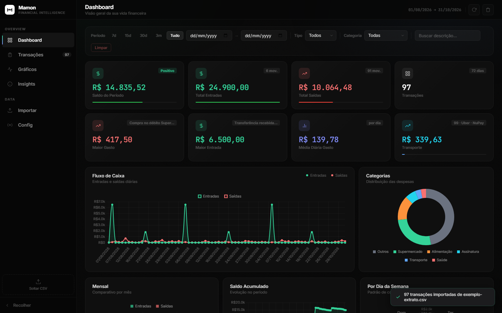

# Mamon

Privacy-first personal finance dashboard: drop a bank statement CSV and analyze it entirely in the browser.

**Live:** https://mamon-azure.vercel.app



## Overview

Mamon turns a bank statement export into a financial dashboard without sending a single byte anywhere. The CSV is parsed and categorized in the browser, so it can be used with real data safely. The screenshot above uses fictitious sample data.

## Features

- Drag and drop import of one or more CSV statements (Nubank format)
- Automatic categorization of transactions
- Balance, income, expenses, biggest expense, daily average and per-category totals
- Cash flow, category, monthly, cumulative balance and weekday charts
- Filters by period, type, category and free-text search
- Export of the cleaned data back to CSV

## Privacy

All processing happens locally. There is no server, no upload and no tracking, and CSV files are ignored by git so personal data never gets committed.

## Tech stack

Vanilla JavaScript, Papa Parse and Chart.js. Static site with no build step, hosted on Vercel.

## Running locally

```bash
npx serve .
```

## Author

Built by [Johnattan Dias](https://github.com/Johnattandias12) ([LinkedIn](https://www.linkedin.com/in/johnattandias)).
